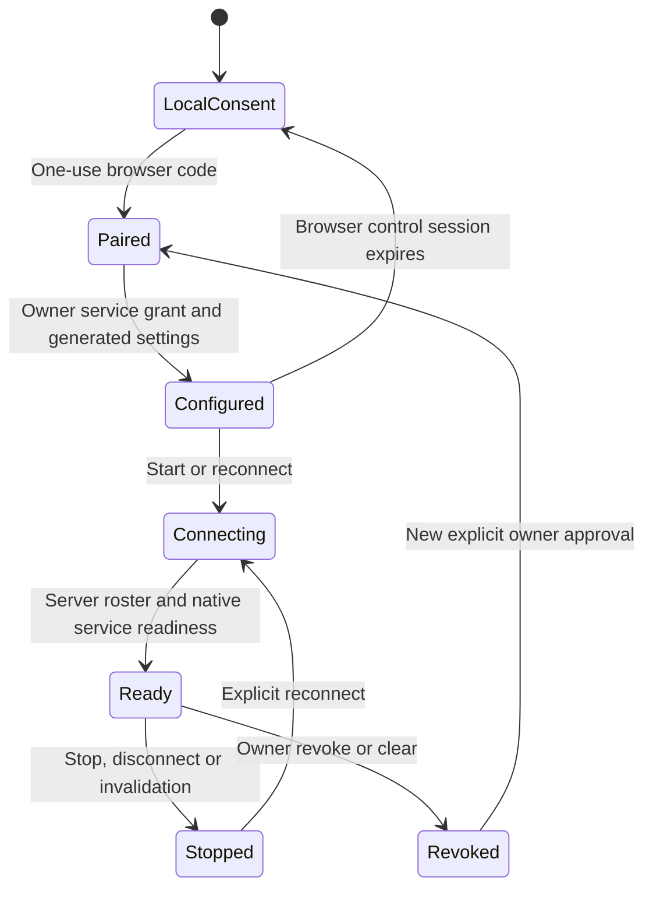

# IfSoul Mineflayer bridge

One Mineflayer player client connects a selected player to an IfSoul character
through private text whispers. With a separate gameplay grant, the Mineflayer
client executes bounded Minecraft actions using native plugins and reports outcomes.

The individual connector accepts private whispers from the approved player,
tracks roster, spawn and lifecycle changes, and returns one private reply.
The separate [group host](#mineflayer-groups) coordinates two or three
Mineflayer clients on the same server.

## Install

Use Node22.18–24 and pnpm10.15.0:

```sh
git clone https://github.com/openifsoul/bridge-minecraft-mineflayer.git
cd bridge-minecraft-mineflayer
pnpm install --frozen-lockfile
pnpm check
```

The repository includes its public SDK dependency and a checksum/source receipt.

## Configure through the App

Run `pnpm companion`, open `http://127.0.0.1:8811`, and explicitly approve the App origin you opened yourself. In the App's **Games → Configure Minecraft → Mineflayer**, enter the one-use local code, select the independent Minecraft server address, bot/player names, owned character/memory and available provider, approve private dialogue, and save/start. The companion generates and persists validated settings; no JSON, UUID or token editing is needed.

The browser does not install or launch the native companion. The one-time installation above requires three preparation commands and `pnpm companion` launches it. Later launches require only `pnpm companion`. Keep that terminal running. The companion binds only literal loopback and accepts an exact locally approved App origin. It has no arbitrary command/file endpoint. Provider keys remain in the selected service.

This path supports authorized Java Minecraft1.20.2 servers in explicit trusted offline mode. It does not alter server authentication or implement Microsoft sign-in. The selected player's UUID is discovered from the actual server roster. IfSoul service and Minecraft TCP endpoints are separate; service HTTPS is required except for loopback HTTP. The companion connects outbound to local/self-hosted/managed service device routes; a cloud service cannot dial your localhost.

Use App **Start**, **Stop**, **Reconnect**, **Clear** and **Revoke**. The native credential expires after one hour; renew through the App. Stop/reconnect fence pending work and never replay uncertain sends. Clear requests remote revocation before removing local settings; unavailable remote confirmation is reported. Re-approving another App origin redacts the previous binding and requires explicit clear, without copying memory. Same-target/profile/memory provider renewal preserves the server-owned host identity and private memory.

Generated settings live under `~/.ifsoul/minecraft` with restricted permissions; operators can set `IFSOUL_COMPANION_DATA_DIR`. Unsupported stored configuration fails without changing it. Only approved private whispers reach the selected character, and output remains a short non-command line.



## Gameplay capabilities

| Capability | Operator approval | Execution |
| --- | --- | --- |
| Private dialogue | Private dialogue grant | Bound player only |
| Follow and walk | Movement permission | Pathfinder follows the bound player, walks to their snapshotted position, or walks to a nearby cardinal point |
| Stop or wait | Movement permission | Send `/tell TaviBot !ifsoul stop` or `/tell TaviBot !ifsoul wait` for immediate cancellation |
| Hostile-mob defense | Movement and defense permissions | The PvP plugin can engage one nearby allowlisted hostile mob selected by the host |

Save and start with an App and companion that both support gameplay. Enable
movement explicitly. Defending against mobs requires its own opt-in. Ask in the
same private whisper you use for dialogue, for example `Follow me` or `Walk five
blocks east`. A provider chooses a structured ID from the host's available
options. The local scenario provider always chooses dialogue.

Each action gets at most 12 seconds and is bounded to 24 blocks. Movement
does not dig or place blocks. A player UUID change, death, dimension change,
disconnect, missed grant verification or an explicit stop clears work. The
reported mob death is observed by the host and does not assert who killed it.
Player attacks, block collection, building and arbitrary commands are outside
this action set.

Pathfinder 2.4.5 and PvP 1.3.2 passed a headless disposable Java 1.20.2 exercise
with synthetic structured decisions. Real-provider and installed-release gameplay
verification are separate.

## Advanced file-driven local test

The original CLI provides dialogue for developer-operated isolated tests.
Gameplay uses App companion grants.

Use a loopback Java Minecraft1.20.2 server with pinned Mineflayer4.39.0 and a
compatible Java runtime. The CLI does not download a server, Java runtime or model,
accept a Minecraft EULA or launch a graphical game client. Follow server terms
and use a server you have permission to connect to.

Copy config.example.json to ignored config.local.json. Set the loopback port,
exact server player UUID/name, world alias and an original character. The
isolatedOfflineServerApproved option explicitly selects the isolated offline
server trust model. The player name is checked against its current UUID on every
request/send. Private-whisper parsing assumes a trusted server and plugins.

```sh
pnpm start -- config.local.json
```

After ready, the selected player sends `/tell TaviBot hello`. Stop with Ctrl-C.
Public chat and unrelated whispers are ignored. Death, dimension changes and
recipient departure invalidate pending work; a playable spawn starts a new
connection. Reconnect manually; uncertain sends are not replayed automatically.

For App mode, start the public App on loopback, select a profile and memory, and
configure an installed provider/model. Set app, provider, model and the returned
profile/memory IDs in the bridge configuration; retain memoryId across reconnect.
Calls are bounded by maxCalls1–10, one in-flight call, queue size2, cooldown and a
deadline. Above60000ms (maximum150000), bridgeLimits.timeoutMs must match the
deadline and App capabilities must accept the configured budget.

Output is one line, at most180characters, without control/format characters or a
leading slash. App owns persistent memory; SDK observations are a bounded local
history. Local cancellation does not guarantee that provider-side work or charges
have stopped. Keep credentials, conversations, saved worlds and logs outside Git.

See [setup reference](docs/fresh-pc.md) and [configuration example](config.example.json).

## Development checks

`pnpm check` runs syntax, version and deterministic fixtures. The optional local
protocol harness uses a supplied server directory:

```sh
IFSOUL_MC_SERVER_DIR=/absolute/path/to/disposable-server \
IFSOUL_DISPOSABLE_TEST_APPROVED=yes node scripts/native-safety.mjs
```

The harness creates its own clients/server and closes them after checking lifecycle,
queue, timeout and private-message behavior. It sends no model requests.

## Mineflayer groups

Create the group in local IfSoul **Games → Minecraft → Mineflayer group**.
Save the approved setup JSON to a private file and run the group host from
this checkout on the same computer as the App.

```sh
pnpm group /path/to/group.json
```

Keep the group host running for the whole play session. Its stop receipt
reports whether a signal arrived, a member disconnected, or the App rejected
a group request. Restart with a fresh setup code from the App. Select the same
character memories to keep the adventure conversation available. Set approved
return points explicitly if actors reconnect somewhere other than home.

The group host runs the authorized clients in the same trusted Minecraft
Java 1.20.2 world. Each bot's pathfinder executes its own bounded survey step
and reports the observed result to the App. Each member retains its own
private conversation with the approved player. A separate grant can allow
bounded survey cadence when no player is present. See the [App group guide](https://github.com/openifsoul/app/blob/main/docs/game-connections.md#run-a-mineflayer-group)
for grant setup, group and addressed messages, movement limits, player-absent
cadence and member removal.

## Continue in local App Conversation

The approved player can whisper `!ifsoul allow-app-chat` to an individual
companion to let the local App operator continue in that player's context.
Linked Conversation can use this connection's private history and update the
character's relationship with that player. Withdraw this permission with
`!ifsoul deny-app-chat`. Owner history inspection has a separate grant. See
the [App memory guide](https://github.com/openifsoul/app/blob/main/docs/memory.md#continue-as-a-mineflayer-player-in-conversation).

## Gather logs into an approved chest

The companion can collect configured log types and deposit only the newly
collected quantity into one approved single chest. Use a trusted server and a
server-managed area where this actor may break the approved blocks and use the
chest. Server protections continue to apply.

Place `resource-policy.json` in the companion data directory
(`~/.ifsoul/minecraft` by default or `IFSOUL_COMPANION_DATA_DIR`) before
starting the companion. Keep this file under the game operator's control.
For example:

```json
{
  "dimension": "overworld",
  "region": {
    "min": { "x": -2, "y": -61, "z": -2 },
    "max": { "x": 14, "y": -56, "z": 6 }
  },
  "resources": ["oak_log", "birch_log"],
  "containers": [
    { "id": "main", "position": { "x": 12, "y": -60, "z": 3 } }
  ]
}
```

Use the dimension reported by your Mineflayer session and coordinates for
the permitted region and chest in that world. The bot needs an axe, space
for the drops and a path within the region. Pair the companion, connect the
bot while the bound player is online and allow `minecraft.gather-deposit`
in App's connection capabilities. The bound player can then privately send
`!ifsoul gather oak_log 8 main` to the bot. The count can be 1–32 and the
resource and chest must match the local policy. Send `!ifsoul stop` or
`!ifsoul wait` to stop subsequent actions. App also checks the permission
before each step and while the action is active.

A pickup requires the bot's collection event and an inventory increase.
The bot reopens the selected chest to verify each deposited item against
the container and inventory counts. A cancelled or partial result reports
the effects the host could verify. Already completed server effects persist
and the bridge does not restart a cancelled job. Use an isolated approved
area when multiple players could modify nearby blocks or the same chest.

Mineflayer also exposes bounded approach, follow, cardinal movement and
defense against supported hostile mobs when those local action plugins and
permissions are enabled. The current bridge has no standalone inventory
commands, crafting, cooking, building, or delegation of work to another NPC.

## Three NPCs in adventure chat

Use a group with three NPCs and opt into public chat both in App and in the
group launcher configuration. Add an `adventure` object beside the group
server and setup code. Set `publicChat` to `true` and supply a `forest`
object with `dimension`, `resources`, `region` and `harvestRegion`.
Both regions use inclusive block coordinates with a `min` and `max`
point. The harvest region must fit inside the movement region. Give each
NPC an axe before the adventure. Allow `minecraft.gather-logs` for each
NPC in App to let it act on the player's instructions.

The group can hear public messages from the selected player when that
player is tracked in its current dimension. Vanilla public chat delivers to
the whole server, so the adventure bridge exposes public listening and
reaction with public speaking disabled. Enable the App's private reply route
to send a response only to the paired player. NPC replies and unrelated
players' messages do not start another turn. The selected player can stop
group tasks with `!group stop` or whisper `!ifsoul stop` to stop one NPC's task.

Each bot reserves a separate work area around its selected block while
collecting its drop and keeps the logs it picks up. Group progress comes
from each bot's own observed pickup and inventory counts.

App can control listening, reacting and speaking separately for each supported
chat channel. The companion and individual bridge provide private dialogue.
The adventure bridge supports scoped group chat and opt-in public input.
Each reply requires current authorization for its destination. A private
reply goes only to the paired Minecraft player.

To return together, allow `minecraft.return-from-forest` for each NPC in App.
The adventure bridge records each NPC’s first valid position in the travel
region as its return point. An operator can set `adventure.returnPoints` to a
map of NPC names to safe positions within that region. A return uses ordinary
native walking and reports arrival only when the NPC reaches its assigned
point. It does not move or teleport the player.

### Group chat with limited recipients

To reach the group without using public chat, whisper
`!group <message>` to the first NPC in the configured group. App can
enable listening, reacting and speaking independently for this channel.
Messages and replies appear as private Minecraft packets. Group replies
use the `[Group]` prefix and go only to the bound player and verified group
members allowed to listen. A directed reply requires its NPC recipient
to be an authorized listener. A public player message remains on the
public channel, subject to its separate settings. Send `!group stop`
to the first NPC to stop the group’s active tasks.
